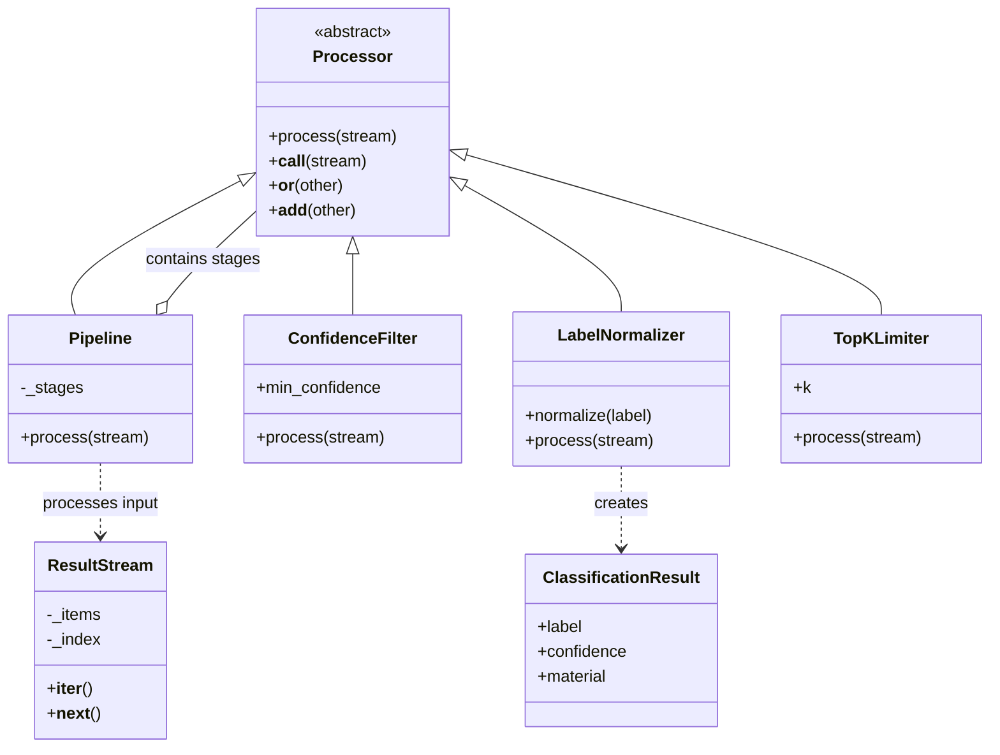

# AI-Powered Waste Sorting & Recycling Assistant

## Homework Assignment 2 – Real-Time Data Processing

**Course:** Python Compact Course  
**University:** FH Dortmund  
**Team Members:** Manjeet Kaur, Deepika Radhakrishnan, Nour Mayssaa Nemer, Karthikeyan Mohana Divya  
**Subsystems:** Waste Classification and Dashboard Stream Processing  
**Git Branch:** `Homeworkassignment002`

---

## 1. Introduction

This assignment focuses on stream processing in the AI-Powered Waste Sorting & Recycling Assistant.

The implementation demonstrates two processing workflows. The Waste Classification pipeline filters predictions based on confidence scores, converts labels into standard material categories, and limits the number of results. The Dashboard pipeline filters scan events by region and date and calculates daily scan counts.

The assignment demonstrates four main Python concepts:

1. Abstract Base Classes (ABCs)
2. Inheritance and Polymorphism
3. Operator Overloading
4. Iterators and Generators

Both workflows are demonstrated using sample data.

## 2. Team Members and Contributions

The project is developed collaboratively, with the following homework responsibilities assigned to team members.
## 1. Team Overview 
## Team and Responsibilities

| Name | Overall role | 1. OOP classes | 2. Stream processing | 3. Flask and MySQL | 4. Errors and tests |
|---|---|---|---|---|---|
| **Manjeet (Classifier)** | Identifies the item in the uploaded photo using a Hugging Face model. | Classes that check the photo and run the model behind one interface (`ImagePreprocessor`, `BaseClassifier`, `ClassifierService`). | Pipeline that drops unsure results, maps labels to materials and keeps the best few (`ConfidenceFilter` \| `LabelNormalizer` \| `TopKLimiter`). | Photo upload route `/api/scan`: validates the image, runs the model, returns the result. | Error classes and handler for bad images and model failures; 57 tests. |
| **Deepika (Rules and Database)** | Decides which bin the item goes in and stores every scan. | Classes for the recycling rules and for saving scans (`RuleSet`, `RulesEngine`, `Database`, `ScanRepository`). | Pipeline that turns results into decisions, adds a lane code and saves them (`DecisionMapper` \| `RoutingCodeAssigner` \| `ScanRecorder`). | SQLAlchemy models and the MySQL connection that save and read scans. | Error classes and handlers for invalid rules and database failures; 43 tests. |
| **Divya (Dashboard)** | Turns saved scans into charts and trends, and built the single page. | Classes that calculate the statistics and build the chart data (`ScanAnalytics`, `ChartBuilder`, `DashboardService`). | Pipeline that filters scans by region and date and counts them per day (`RegionFilter` \| `DateRangeFilter` \| `DailyAggregator`). | `/api/dashboard` route and the single page with the photo buttons and charts. | Error class and handler for the dashboard; 35 tests. |
| **Mayassa (AI Coach)** | Writes the tips and fun fact, with offline tips if the AI is down. | Classes that ask the AI for advice or use offline tips (`PromptBuilder`, `OpenAICoach`, `OfflineCoach`, `CoachService`). | Pipeline that builds the prompt, gets advice and cleans the tips (`PromptStage` \| `AdviceStage` \| `TipCleaner` \| `TipLimiter`). | Connects the KI:connect AI to the scan response, with an offline fallback. | Error class and handler for an unavailable AI, plus the fallback; 40 tests. |

**Shared by everyone:** Connecting the four subsystems, the shared error structure, the README, the UML diagrams and the video.


## 3. Files and Classes Used

### 3.1 Waste Classification Stream Processing

The main processing classes are defined in `app/streaming/processors.py`.

| Class | Purpose |
|---|---|
| `Processor` | Defines a common interface for processing stages |
| `Pipeline` | Connects multiple processing stages |
| `ResultStream` | Provides predictions one at a time |
| `ConfidenceFilter` | Removes predictions with low confidence |
| `LabelNormalizer` | Converts prediction labels into material categories |
| `TopKLimiter` | Limits the number of results |

The `ClassificationResult` class in `app/classifier/models.py` stores the classification label, confidence score, and material category.

The classification workflow is demonstrated in `demo_classification_stream.py`.

### 3.2 Dashboard Stream Processing

The dashboard processing classes are defined in `app/dashboard/stream.py`.

| Class | Purpose |
|---|---|
| `ScanEventStream` | Provides scan events to the dashboard pipeline |
| `RegionFilter` | Filters scan events by region |
| `DateRangeFilter` | Filters scan events within a selected date range |
| `DailyAggregator` | Calculates daily scan counts |

The dashboard workflow is demonstrated in `demo_dashboard_stream.py`.

## 4. Python Concepts Demonstrated

### 4.1 Abstract Base Classes

The `Processor` class uses `ABC` and `@abstractmethod` to define a common processing interface.

```python
class Processor(ABC):

    @abstractmethod
    def process(self, stream):
        """Yield processed events lazily."""
```

Concrete child classes implement the `process()` method according to their processing requirements.

### 4.2 Inheritance and Polymorphism

`Pipeline`, `ConfidenceFilter`, `LabelNormalizer`, and `TopKLimiter` inherit from `Processor`.

Each class implements the same `process()` method but performs a different operation. For example, `ConfidenceFilter` checks confidence scores, while `LabelNormalizer` converts prediction labels into material categories.

### 4.3 Operator Overloading

The `__or__()` and `__add__()` methods allow processing stages to be connected using the `|` or `+` operators.

Example:

```python
pipeline = (
    ConfidenceFilter(0.35)
    | LabelNormalizer()
    | TopKLimiter(3)
)
```

This connects three processing stages into a single pipeline.

The dashboard demonstration also uses the pipe operator to connect its processing stages.

### 4.4 Iterators and Generators

The `ResultStream` class implements `__iter__()` and `__next__()` to provide predictions one at a time.

The classification processing stages use `yield` to produce results incrementally.

Example:

```python
def process(self, stream):
    for event in stream:
        if event.confidence >= self.min_confidence:
            yield event
```

Only predictions meeting the confidence threshold are passed to the next stage.

## 5. UML Class Diagram

The following UML diagram shows the main classes and their relationships in the Waste Classification stream-processing framework.



`Processor` is the abstract parent class. The four processing classes inherit from it, while `Pipeline` connects the stages. `ResultStream` provides input predictions, and `ClassificationResult` stores the processed classification results.

The dashboard pipeline uses separate components for event streaming, region filtering, date filtering, and daily aggregation.

## 6. Stream Processing Workflows

### 6.1 Waste Classification Workflow

```text
Input Predictions
        |
        v
    ResultStream
        |
        v
ConfidenceFilter(0.35)
        |
        v
   LabelNormalizer
        |
        v
   TopKLimiter(3)
        |
        v
    Final Results
```

The workflow performs three main operations:

1. **Confidence Filtering:** Predictions with confidence below 35% are removed.
2. **Label Normalization:** Prediction labels are converted into standard material categories, such as PET to plastic, aluminum can to metal, and battery to e-waste.
3. **Result Limiting:** `TopKLimiter(3)` allows a maximum of three results.

### 6.2 Dashboard Stream Processing Workflow

```text
Input Scan Events
        |
        v
  ScanEventStream
        |
        v
RegionFilter("Dortmund")
        |
        v
DateRangeFilter(start, end)
        |
        v
 DailyAggregator
        |
        v
  Daily Scan Counts
```

The dashboard workflow selects scan events from a specified region, applies a date range, and calculates the number of scans for each day.

## 7. Demonstration and Results

### 7.1 Waste Classification Demonstration

**Demo file:** `demo_classification_stream.py`

The pipeline was tested using four sample predictions.

| Prediction | Confidence | Result |
|---|---|---|
| PET | 95% | Plastic |
| HDPE | 20% | Removed |
| Aluminum can | 88% | Metal |
| Battery | 80% | E-waste |

**Run the demo:**

```powershell
python demo_classification_stream.py
```

**Output:**

```text
Pipeline: ConfidenceFilter | LabelNormalizer | TopKLimiter
Total input predictions: 4

Processed results:
Label: PET | Confidence: 95% | Material: plastic
Label: aluminum can | Confidence: 88% | Material: metal
Label: battery | Confidence: 80% | Material: e-waste
```

HDPE is removed because its confidence is below the 35% threshold. The remaining predictions are converted into standard material categories.

### 7.2 Dashboard Stream Processing Demonstration

**Demo file:** `demo_dashboard_stream.py`

The dashboard pipeline was tested using five sample scan events from Dortmund and Berlin.

The selected region is Dortmund, and the date range is November 1–5, 2026.

The processing pipeline is:

```python
pipeline = (
    RegionFilter("Dortmund")
    | DateRangeFilter(start, end)
    | DailyAggregator(start, end)
)
```

**Run the demo:**

```powershell
python demo_dashboard_stream.py
```

**Output:**

```text
Pipeline: RegionFilter | DateRangeFilter | DailyAggregator
2026-11-01 ## 2
2026-11-02  0
2026-11-03 # 1
2026-11-04 # 1
2026-11-05  0
```

The output shows the daily number of scan events for Dortmund.

November 1 has two scans, while November 3 and 4 have one scan each. November 2 shows zero because the event belongs to Berlin and is removed by the region filter. November 5 also shows zero because no scan event is available for that date.

The hash symbols provide a simple visual representation of the daily counts.

### 7.3 Demonstration Scope

Both demonstrations use sample data to verify the stream-processing workflows. The classification demonstration does not require a live camera feed, and the dashboard demonstration does not require live scan events.

Bounding-box processing and physical conveyor routing are not included in these demonstrations.

## 8. Presentation Video

**Title:** Homework Assignment 2 – Waste Classification and Dashboard Stream Processing

**Duration:** Approximately 5-8 minutes

**Video Link:** [Watch the presentation on Google Drive](https://drive.google.com/file/d/1usBMly2xbPwhD3ISNYgdeGlLLwJBiDUh/view?usp=sharing)

The video explains the main Python concepts, processing files, UML class diagram, and the outputs of both demonstrations.

## 9. Conclusion

Homework Assignment 2 demonstrates stream processing through two workflows: Waste Classification and Dashboard Processing.

The classification pipeline filters predictions and converts labels into material categories. The dashboard pipeline filters scan events and calculates daily statistics.

The implementation demonstrates Abstract Base Classes, Inheritance, Polymorphism, Operator Overloading, Iterators, and Generators, showing how reusable processing components can be combined to process and organize data.