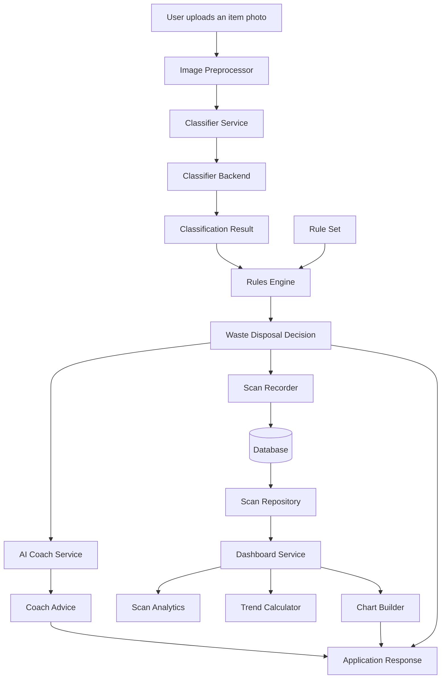

# AI-Powered Waste Sorting Assistant

Home Assignment 1: translating the capstone UML architecture into Object-Oriented Python classes.

A user takes a photo of an item. An AI model classifies the material, local rules (Dortmund) decide which bin it belongs in, an AI coach gives tips, and a dashboard shows recycling statistics.

---

## 1. Team Overview

| Team member | Subsystem | Implemented classes | Source files |
|---|---|---|---|
| [Manjeet] | Classifier | `WasteImage`, `PredictionResult`, `WasteClassifier`, `ModelEvaluator` | `app/classifier/classifier_oop.py` |
| [Deepika] | Rules and Database | `Rule`, `RuleSet`, `Decision`, `RulesEngine`, `Database`, `ScanRepository` | `app/rules/` |
| [Mayssaa] | AI Coach | `PromptBuilder`, `CoachAdvice`, `BaseCoach`, `OfflineCoach`, `OpenAICoach`, `CoachService` | `app/coach/` |
| [Divya] | Dashboard | `ScanAnalytics`, `TrendCalculator`, `ChartBuilder`, `DashboardService` | `app/dashboard/` |

Every class has:

1. **A constructor** (`__init__`) that initialises its state and validates its input.
2. **Initialisation methods** where setup logic applies (for example `WasteClassifier.initialize_model()`, `RuleSet.load_defaults()`, `Database.initialize()`, `ScanAnalytics.initialize()`).
3. **Encapsulation**: private attributes exposed through getters and setters, with validation in the setters. The Classifier classes use explicit `get_...()` / `set_...()` methods; the other subsystems use Python `@property` and `@<name>.setter`.

---

## 2. System Design

### 2.1 Overall flow



### 2.2 Classifier subsystem

classDiagram
    class BaseClassifier {
        <<abstract>>
        -name
        -ready
        +name
        +is_ready
        +ensure_ready()
        +initialize()*
        +predict(image)*
    }
    class HuggingFaceClassifier {
        -top_k
        +initialize()
        +predict(image)
    }
    class ClipZeroShotClassifier {
        +initialize()
        +predict(image)
    }
    class SigLIP2Classifier {
        +initialize()
        +predict(image)
    }
    class ClassificationResult {
        -label
        -confidence
        -material
        +label
        +confidence
        +material
        +to_dict()
    }
    class ImagePreprocessor {
        -max_bytes
        -max_side
        +initialize()
        +prepare(data)
    }
    class ClassifierService {
        -backend
        -preprocessor
        -min_confidence
        +build_pipeline()
        +classify(data)
    }
    class WasteImage {
        -image_path
        +get_image_path()
        +set_image_path(image_path)
        +load_image()
    }
    class PredictionResult {
        -label
        -confidence
        +get_label()
        +set_label(label)
        +get_confidence()
        +set_confidence(confidence)
    }
    class WasteClassifier {
        -model_name
        -processor
        -model
        +get_model_name()
        +set_model_name(model_name)
        +initialize_model()
        +classify(waste_image)
    }
    class ModelEvaluator {
        -actual_labels
        -predicted_labels
        +get_actual_labels()
        +set_actual_labels(labels)
        +get_predicted_labels()
        +set_predicted_labels(labels)
        +add_prediction(actual_label, predicted_label)
        +reset()
        +evaluate()
    }

    BaseClassifier <|-- HuggingFaceClassifier
    BaseClassifier <|-- ClipZeroShotClassifier
    BaseClassifier <|-- SigLIP2Classifier
    ClassifierService --> BaseClassifier : uses selected backend
    ClassifierService --> ImagePreprocessor : preprocesses input
    ClassifierService ..> ClassificationResult : returns results
    SigLIP2Classifier ..> WasteClassifier : delegates to
    WasteClassifier --> WasteImage : receives
    WasteClassifier ..> PredictionResult : creates
    ModelEvaluator ..> PredictionResult : evaluates label values from

### 2.3 Rules and Database subsystem

classDiagram
    class Rule {
        -material
        -bin_name
        -recyclable
        -instructions
        +material
        +bin_name
        +recyclable
        +instructions
    }
    class RuleSet {
        -region
        -rules
        +region
        +load_defaults()
        +add_rule(rule)
        +get_rule(material)
        +materials()
    }
    class Decision {
        +label
        +confidence
        +rule
        +region
        +material
        +bin_name
        +recyclable
        +instructions
        +to_dict()
    }
    class RulesEngine {
        -ruleset
        +ruleset
        +region
        +decide(result)
    }
    class Database {
        -url
        -engine
        -sessions
        +url
        +initialize()
        +create_tables()
        +session()
    }
    class Scan {
        +id
        +created_at
        +label
        +material
        +bin_name
        +recyclable
        +confidence
        +region
        +to_dict()
    }
    class ScanRepository {
        -db
        +database
        +add(decision)
        +list_scans(region)
        +count()
    }
    class RoutedDecision {
        -decision
        -lane_code
        +decision
        +lane_code
        +to_dict()
    }
    class DecisionMapper {
        -engine
        +engine
        +process(stream)
    }
    class RoutingCodeAssigner {
        -codes
        -fallback
        +codes
        +fallback
        +initialize(codes, fallback)
        +code_for(material)
        +process(stream)
    }
    class ScanRecorder {
        -repository
        +repository
        +process(stream)
    }

    RuleSet o-- Rule : contains rules
    RulesEngine --> RuleSet : uses
    RulesEngine ..> Decision : creates
    Decision --> Rule : contains selected rule
    ScanRepository --> Database : uses
    ScanRepository ..> Scan : persists and retrieves
    ScanRepository ..> Decision : stores decision data
    DecisionMapper --> RulesEngine : maps classifications
    DecisionMapper ..> RoutedDecision : creates stream item
    RoutingCodeAssigner ..> RoutedDecision : adds routing code
    ScanRecorder --> ScanRepository : records decisions

### 2.4 AI Coach subsystem

classDiagram
    class CoachAdvice {
        +headline
        +tips
        +fun_fact
        +source
        +to_dict()
    }
    class PromptBuilder {
        -region
        -language
        +region
        +language
        +build(decision)
    }
    class BaseCoach {
        <<abstract>>
        -prompts
        +prompts
        +advise(decision)*
    }
    class OfflineCoach {
        +FACTS
        +advise(decision)
    }
    class OpenAICoach {
        -api_key
        -model
        +model
        +advise(decision)
    }
    class CoachService {
        -primary
        -fallback
        +primary
        +advise(decision)
    }

    BaseCoach <|-- OfflineCoach
    BaseCoach <|-- OpenAICoach
    BaseCoach --> PromptBuilder : uses
    CoachService --> BaseCoach : primary coach
    CoachService --> BaseCoach : fallback coach
    OfflineCoach ..> CoachAdvice : creates
    OpenAICoach ..> CoachAdvice : creates


### 2.5 Dashboard subsystem

classDiagram
    class ScanAnalytics {
        -scans
        +scans
        +initialize()
        +total()
        +recycling_rate()
        +average_confidence()
        +count_by(attribute)
        +daily_counts(days, today)
    }
    class TrendCalculator {
        -tolerance
        +tolerance
        +initialize()
        +direction(series)
    }
    class ChartBuilder {
        -default_color
        -palette
        +default_color
        +palette
        +initialize()
        +material_chart(counts)
        +bin_chart(counts)
        +trend_chart(daily)
    }
    class DashboardService {
        -repository
        -region
        -days
        +repository
        +region
        +days
        +initialize()
        +build(today)
    }
    class ScanRepository {
        +list_scans(region)
    }

    DashboardService --> ScanRepository : reads scan records from
    DashboardService ..> ScanAnalytics : creates
    DashboardService ..> TrendCalculator : initializes and uses
    DashboardService ..> ChartBuilder : initializes and uses

## 3. Presentation Link


## Setup and run

```powershell
python -m venv .venv
.venv\Scripts\activate
pip install -r requirements.txt
copy .env.example .env
python run.py
```

Open http://127.0.0.1:5000 in a browser.
