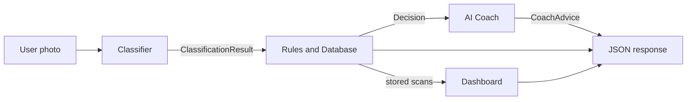
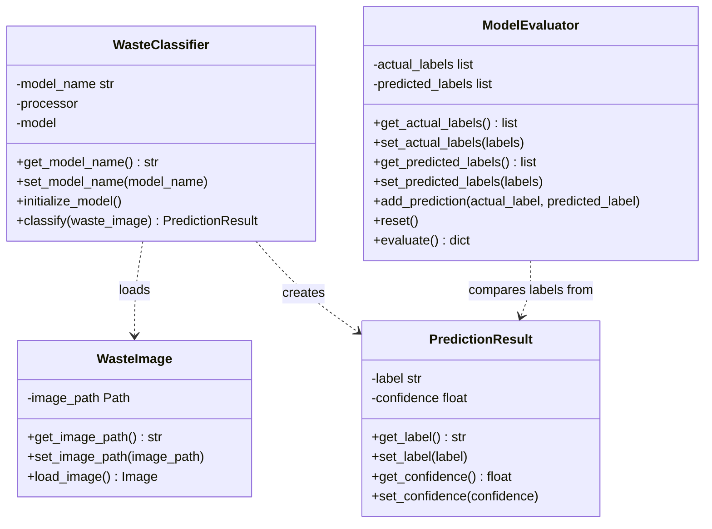
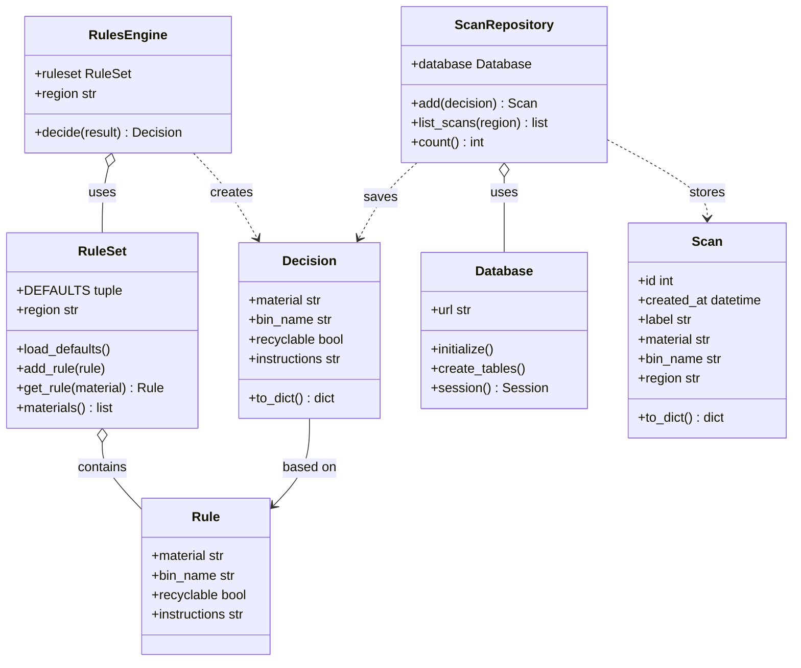
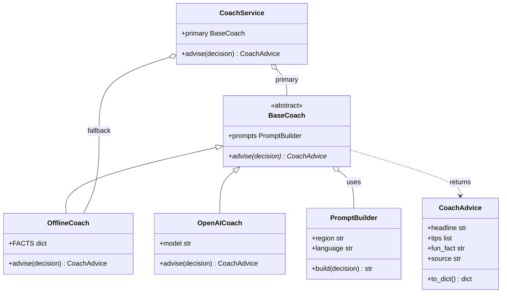
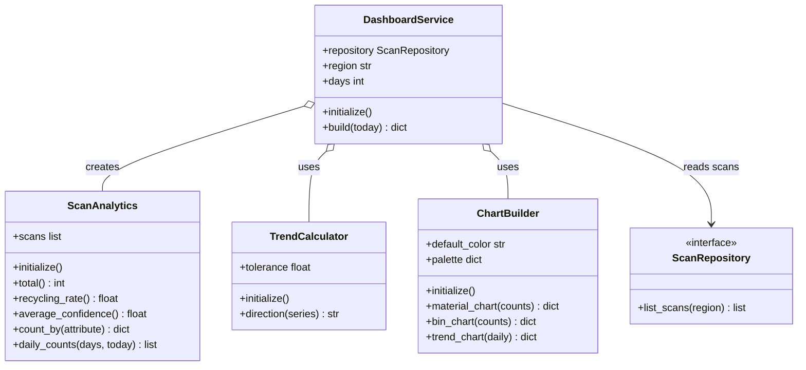

# AI-Powered Waste Sorting Assistant

Home Assignment 1: translating the capstone UML architecture into Object-Oriented Python classes.

A user takes a photo of an item. An AI model classifies the material, local rules (Dortmund) decide which bin it belongs in, an AI coach gives tips, and a dashboard shows recycling statistics.

---

## 1. Team Overview

| Team member | Subsystem | Implemented classes | Source files |
|---|---|---|---|
| [Manjeet] | Classifier | `WasteImage`, `PredictionResult`, `WasteClassifier`, `ModelEvaluator` | `app/classifier/classifier_oop.py` |
| [Deepika] | Rules and Database | `Rule`, `RuleSet`, `Decision`, `RulesEngine`, `Database`, `ScanRepository` | `app/rules/` |
| [Mayssaa] | AI Coach | `PromptBuilder`, `CoachAdvice`, `BaseCoach`, `OfflineCoach`, `OpenAICoach`, `CoachService` | `app/coach/` |
| [Divya] | Dashboard | `ScanAnalytics`, `TrendCalculator`, `ChartBuilder`, `DashboardService` | `app/dashboard/` |

Every class has:

1. **A constructor** (`__init__`) that initialises its state and validates its input.
2. **Initialisation methods** where setup logic applies (for example `WasteClassifier.initialize_model()`, `RuleSet.load_defaults()`, `Database.initialize()`, `ScanAnalytics.initialize()`).
3. **Encapsulation**: private attributes exposed through getters and setters, with validation in the setters. The Classifier classes use explicit `get_...()` / `set_...()` methods; the other subsystems use Python `@property` and `@<name>.setter`.

---

## 2. System Design

### 2.1 Overall flow



### 2.2 Classifier subsystem



### 2.3 Rules and Database subsystem



### 2.4 AI Coach subsystem



### 2.5 Dashboard subsystem



---

## 3. Presentation Link


## Setup and run

```powershell
python -m venv .venv
.venv\Scripts\activate
pip install -r requirements.txt
copy .env.example .env
python run.py
```

Open http://127.0.0.1:5000 in a browser.
